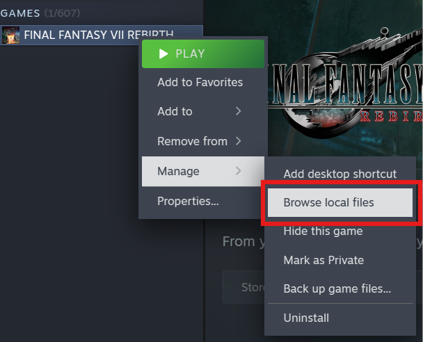
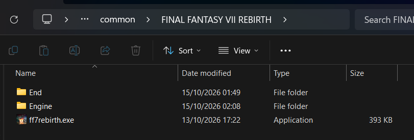
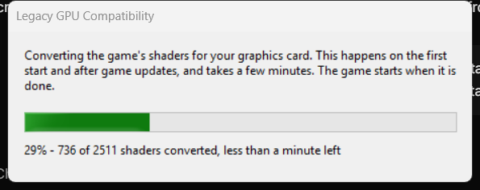

# Legacy GPU Compatibility for FF7 Rebirth

> [!IMPORTANT]
> **Unofficial fan project.** Not affiliated with, sponsored by, or endorsed by Square Enix.

Play FINAL FANTASY VII REBIRTH on graphics cards without mesh shaders, including the NVIDIA
GTX 10 series. This mod gets supported older hardware past the game's **“DX12 is not supported
on your system”** check and replaces mesh-shader work with compute and vertex shaders.

**[Download](https://github.com/agustinmorantes/FF7RebirthLegacyGPUCompat/releases)** ·
[Installation](#installation) ·
[Wiki](https://github.com/agustinmorantes/FF7RebirthLegacyGPUCompat/wiki) ·
[Report a bug](https://github.com/agustinmorantes/FF7RebirthLegacyGPUCompat/issues)

**Experimental. Tested on a GTX 1070**, with extended in-game use reported without issues.
Other GPUs remain untested. This is a compatibility mod; performance depends on your card,
settings and the area of the game.

## What it does

- Handles the game's graphics capability checks through a `d3d12.dll` proxy.
- Runs converted mesh shaders as ordinary compute and vertex shaders, and replaces the shaders
  whose 16-bit buffer loads can be converted to 32-bit.
- Converts shaders from **your own game installation** on first start and after game updates.
  The release contains no game shaders.

See [How it works](docs/how-it-works.md) for the technical details.

## Installation

You need the **Steam version on Windows 10/11** and about **150 MB** of free space in the game
folder. The release includes the conversion tools; no separate Python or developer tools
installation is needed.

**In the ZIP:** the proxy DLL, default configuration, conversion tools, readme and licenses.
**Generated on your PC:** `legacygpu_shaders`, built from your own installed copy of the game
on first launch. You do not need a shader pack matched to a particular Steam build.

1. **Close the game and download the release ZIP.** Choose `LegacyGPUCompat-<version>.zip`
   from [Releases](https://github.com/agustinmorantes/FF7RebirthLegacyGPUCompat/releases),
   rather than GitHub's source-code ZIP.
2. **Open the game folder.** In Steam, right-click the game → **Manage → Browse local files**.
   Before extracting, remove any other mod's `d3d12.dll` from `End\Binaries\Win64`, such as a
   feature-level spoof. This mod already handles that check.
3. **Extract the entire ZIP into the folder containing `End`**, merging the folders.
   Do not extract into `Win64` or leave the files inside an extra ZIP-named folder.
4. **Check the result and launch.** `d3d12.dll`, `legacygpu.ini` and `legacygpu_tools` must be
   directly inside `End\Binaries\Win64`.

**Open the installation folder:** right-click FINAL FANTASY VII REBIRTH in your Steam library,
then select **Manage → Browse local files**.



**Extract the ZIP here:** the game root contains `End`, `Engine` and `ff7rebirth.exe`.
Merge the ZIP's `End` folder with the existing one. Your drive and installation path may differ.



### What to expect on first start

The mod converts the game's shaders **before the game appears**. Allow a few minutes,
depending on your CPU. The progress window appears if conversion takes longer than six seconds.
Afterward, the game may compile its own shaders too. Let both finish.



*Example conversion window. Shader counts and time estimates vary by game build and CPU.*

Successful unchanged starts skip conversion. After game updates, the mod converts new or
changed shaders automatically; an engine change can still require a mod update.

[Full installation guide, updating and uninstalling →](https://github.com/agustinmorantes/FF7RebirthLegacyGPUCompat/wiki/Installation)

## Compatibility and performance

| Graphics card | Status |
|---|---|
| NVIDIA GTX 10 series (Pascal) | Tested on a GTX 1070. |
| NVIDIA GTX 900, AMD RX 400/500, RX Vega and RX 5000 | Untested targets. They lack mesh shaders, but may encounter other hardware or driver limits. |
| GTX 16, RTX, RX 6000+ and Intel Arc | Have mesh shaders; this mod is not needed. |

The documented test setup is a GTX 1070 with driver 580.97 and Steam build 23447986, at
1440p, 66% render scale and Medium settings, at about **37 FPS**. This is one measured setup,
not a prediction for other cards or areas.

Some reflection shaders are skipped, and a sudden increase in geometry can briefly leave
objects missing while the emulation buffers adapt.
[GPU details and known limitations →](https://github.com/agustinmorantes/FF7RebirthLegacyGPUCompat/wiki/Compatibility)

### Recommended optional mods

| Mod | Purpose and installation |
|---|---|
| [ShaderInjector](https://github.com/frostbone25/ShaderInjector) | Visual adjustments. Follow its [installation guide](https://github.com/frostbone25/ShaderInjector/blob/main/INSTALL.md), using its `dsound.dll` loader. |
| [OptiScaler](https://github.com/optiscaler/OptiScaler) | Alternative upscalers and frame generation. Install as `dxgi.dll`; XeFG is an optional output where supported. Follow the [OptiFG guide](https://github.com/optiscaler/OptiScaler/wiki/OptiFG). |

Keep this mod as **`d3d12.dll`**. Other mods using that same filename conflict with it.
Install and check each optional mod separately before combining them. For combined setups, see
ShaderInjector's [compatibility notes](https://github.com/frostbone25/ShaderInjector/blob/main/Solutions.md).
These are separate downloads. XeFG frame generation is separate from XeSS upscaling and does
not increase the underlying game simulation rate.

## Help and configuration

Keep the defaults in `legacygpu.ini` for normal play. Each option is documented there;
leave diagnostics at `0` unless needed for an investigation.

If startup or rendering fails, first check the extraction paths and test with other mods
removed. Report your GPU, driver, game build, mod version and reproduction steps, and attach
**`End\Binaries\Win64\legacygpu.log`**.

[Troubleshooting and bug-report guide →](https://github.com/agustinmorantes/FF7RebirthLegacyGPUCompat/wiki/Troubleshooting)

To uninstall, close the game and remove `d3d12.dll`, `legacygpu.ini`, `legacygpu.log`,
`legacygpu_README.txt`, `legacygpu_LICENSE.txt`, `legacygpu_tools` and `legacygpu_shaders`
from `End\Binaries\Win64`.

## For developers

The repository includes the DLL source, converters and synthetic test fixtures. Ignored build
outputs and download caches are regenerated; private extracts are not required to build it.
The converters operate on DXIL and may be useful for other projects that need mesh shaders.

[Build guide](https://github.com/agustinmorantes/FF7RebirthLegacyGPUCompat/wiki/Build-from-source) ·
[Runtime architecture](docs/how-it-works.md) ·
[Research tools](tools/research/README.md)

<details>
<summary>Build commands, manual shader conversion and release packaging</summary>

## Build from source

Requirements:

- Windows 10/11.
- Visual Studio 2022 or newer, or its Build Tools, with the MSVC x64 compiler and a Windows SDK.
  CMake and Ninja must be on `PATH` (Visual Studio includes both).
- Python 3.11+ on `PATH`, plus the packages in `requirements.txt`.

```powershell
python -m pip install -r requirements.txt
.\proxy\build.cmd
python proxy\test\run_tests.py
```

The first configure downloads the [DirectX Shader Compiler](https://github.com/microsoft/DirectXShaderCompiler)
v1.9.2609 release into `tools\dxc-1.9.2609` (checked against its SHA-256). The build produces
`proxy\build\d3d12.dll` and the test harness `proxy\build\proxytest.exe`. The tests run on the
local GPU.

### Build the shader library from your game

```
python tools\build_shaders.py "<game dir>" "<game dir>\End\Binaries\Win64\legacygpu_shaders"
```

`<game dir>` is the folder that contains `End`, for example
`C:\Program Files (x86)\Steam\steamapps\common\FINAL FANTASY VII REBIRTH`. Allow a few minutes
for the first conversion, depending on your CPU. Later runs only convert what changed. A handful of shaders are reported as
skipped, which is expected (see the limitations in [docs/how-it-works.md](docs/how-it-works.md)).
Copy `proxy\build\d3d12.dll` and `proxy\build\legacygpu.ini` to the same `Win64` folder to finish
a manual install. Without a `legacygpu_tools` folder next to it, the DLL uses `legacygpu_shaders`
as it is and doesn't convert anything itself.

### Package a release

```
python tools\package_release.py <version>
```

This writes `dist\LegacyGPUCompat-<version>.zip`, laid out to be extracted into the game folder.
It contains the DLL, the ini and `legacygpu_tools`, which holds the converter scripts, DXC and
dxilasm, and the official embeddable Python with python-lz4. Python and lz4 are downloaded once
into `tools\downloads` and checked against pinned SHA-256 hashes. The zip contains no game files.
A matching `.zip.sha256` file is written alongside the archive for download verification.

</details>

## Legal

The code in this repository is MIT-licensed (see [LICENSE](LICENSE)). Neither the repository nor
the release zips contain game files. The mod converts the shaders of the player's own copy of the
game on their PC. Release zips bundle Python (PSF license), python-lz4 (BSD) and the DirectX
Shader Compiler (LLVM and Microsoft binary license terms), each with its license file. This is an unofficial fan project, not
affiliated with or endorsed by Square Enix.

## Acknowledgements

Thanks to [frostbone25 and the ShaderInjector contributors](https://github.com/frostbone25/ShaderInjector).
Their open-source project served as a reference for hooking D3D12 shader creation during this
mod's development. ShaderInjector is a separate project; this mod is not an official component of it.
